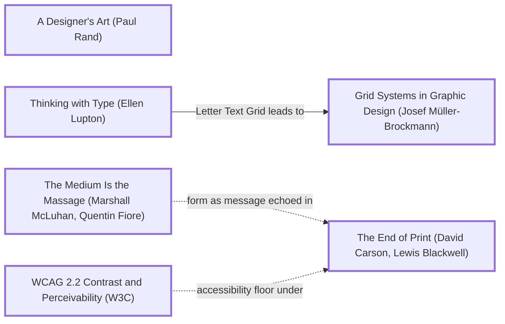

# DESIGN-LOG: Learn Java, "from the bytes up"

DADA run, 2026-11-11. Repo: SolutionsAsService/LearnJava, which was empty when the run started.

## 1. Traversal Plan

**Brief, one sentence:** build from scratch a beautiful multi-page site that teaches Java, then add it to the portfolio and the coding roadmap.

**Mode: Adaptive.** The site serves learners. MAYA governs: the advanced pole is a home page drawn from the real bytes of a compiled class; the acceptable pole is a numbered lesson path with code, output and the command to run it.

**Run type: Full.** The owner said "from scratch", "full run" and "new … website", and the repo is empty. That last fact is why R0 is skipped: there is no inherited artifact to premortem.

**Owner's words:** "do a from scratch dada run for Java website make sure dada has from scratch keywords for new full run aestitic website to learn Java then add to roadmap and portfolio". No bound was given.

**Before the run:** the requested keywords were added to DADA (dada-changes `b1de2c4`). The skill's description, the run-type rule and `dada.manual.json` (manual 1.2.0) now name from scratch, new site, full run, start over, rebuild and an empty repo as Full triggers.

### Tooling inventory (Step 0)
| Job | Tool used |
|---|---|
| Anchor graph | Mermaid text in this log |
| Frontier | grep over `references/anchor-graph.md` |
| Panel | Agent tool: one general-purpose agent per reference, at most three at a time, each writing a file into `panel/R<n>/` |
| Choose panel | `scripts/pick_panel.py --mode adaptive --run-type full --project learnjava --data-graphic` |
| Brief seats | `seats/<seat_id>.md` |
| Measure | Playwright (`_src/measure.cjs`, which enumerates every page in `site/`); the Mobile Floor via `scripts/check_floor.py`; javac, java and javap at build |
| Record the run | `import_log.py` and `rate_seats.py` in dada-changes |

### Seed (labels copied from the graph)
- Stance: **A Designer's Art (Paul Rand)**: wit, and a symbol the reader can decode.
- Rule: **Thinking with Type (Ellen Lupton)** --Letter Text Grid leads to--> **Grid Systems in Graphic Design (Josef Müller-Brockmann)**
- Breaker: **The Medium Is the Massage (Marshall McLuhan, Quentin Fiore)**: the class file, the medium Java actually travels in, becomes the message.
- Counterpoint (dotted): **The End of Print (David Carson, Lewis Blackwell)**, reached by `mcluhan -.->|form as message echoed in| carson`
- Floor: **WCAG 2.2 Contrast and Perceivability (W3C)**, plus the Mobile Floor (`references/mobile-standard.md`)

### Panel (from `pick_panel.py`, copied)
| Seat | Why |
|---|---|
| Critic: Provocateur (Debord) | required by the adaptive panel minimum |
| Critic: Provocateur (Shklovsky) | required by the adaptive panel minimum |
| Critic: Inclusion (Holmes) | required by the adaptive panel minimum |
| Critic: Inclusion (Mace) | required by the adaptive panel minimum |
| Critic: Evidence (Cairo) | required: the artifact can be inspected |
| Critic: Evidence (Tufte) | required: a data graphic gets the instrumentation seat |
| Critic: Usability (Krug) | rated 0.877 over 95 rounds |
| Critic: Aestheticist (Gautier) | rotation seat, 0 rounds on record |

Dotted pairs: Debord and Krug; Shklovsky and Krug. Content-owner witness: none. Java is a public standard; facts are checked against JDK 21 in this container and against the official sources linked on each page.

## Frontier
| Candidate | Reached via | From anchor | Status |
|---|---|---|---|
| Programme: every page generated from examples/ and the compiler | Lessons 44, 47, and the LearnC carry-forward | n/a | TAKEN (M1) |
| Type-led grid: the byte cell as the module | Letter Text Grid leads to | Thinking with Type (Ellen Lupton) | TAKEN (M2) |
| The class file as the hero and the site map | (Breaker) | The Medium Is the Massage (Marshall McLuhan, Quentin Fiore) | TAKEN (M3) |
| The magic number set huge, breaking the grid | form as message echoed in (dotted) | The End of Print (David Carson, Lewis Blackwell) | TAKEN (M3) |
| Shadw/Vercel config and the Mobile Floor from the first commit | website rule, floors | WCAG 2.2 Contrast and Perceivability (W3C) | TAKEN (M4) |

## Move M1: The programme: the compiler writes the evidence (KEEP-THE-RULE)
Depends on: none
Anchors: Rule Thinking with Type (Ellen Lupton)
Intent: every lesson page shows its program, the exact command, the JDK version and the real output, all written by `_src/build.py` after it compiles each file with `javac -Xlint:all` and runs it. The JVM page prints the real `javap -c` of Hello.
Formal argument: claim: a learning site's authority is its outputs. Grounds: the LearnC run's defects were all claims the build did not back. Warrant: the medium (compiler output) carries the message, so nothing is typed by hand.
Alternatives rejected: (1) a browser JVM (heavy, and it hides the real toolchain); (2) hand-written outputs, which drift.
Consequence: the build needs a JDK. Without one it reuses `_src/runs.json` and says so.
Fence: none broken.
Frontier effect: hero figures (bytes, version, pool size) become computable.
Mode field: Advanced pole: the compiler's own output as the content. Acceptable pole: code, then output, then the command; the most familiar teaching shape.

## Move M2: The byte cell as the module (KEEP-THE-RULE)
Depends on: M1
Anchors: Rule Thinking with Type (Ellen Lupton) | Rule Grid Systems in Graphic Design (Josef Müller-Brockmann)
Intent: the layout module is one byte, two hex digits of IBM Plex Mono. A 16-byte row (the width of a hex dump) sets the code column. Prose in Fraunces holds about 66 characters.
Alternatives rejected: a 12-column fluid grid, which is unrelated to the subject; full-bleed code, whose lines are too long.
Mode field: Advanced pole: the grid is the subject's own unit. Acceptable pole: an ordinary reading measure.

## Move M3: The home page is Hello.class (BREAK)
Depends on: M1, M2
Anchors: Stance A Designer's Art (Paul Rand) | Breaker The Medium Is the Massage (Marshall McLuhan, Quentin Fiore) | Counterpoint The End of Print (David Carson, Lewis Blackwell) (dotted edge from The Medium Is the Massage (Marshall McLuhan, Quentin Fiore))
Intent: the landing graphic is the complete compiled class file of the first lesson, every byte, drawn as a hex dump. Its regions are tinted and numbered: ① the magic number CA FE BA BE, ② the class-file version, ③ the constant pool, ④ the class header, ⑤ the main method's bytecode, ⑥ the attributes. Each region is a link to the page that explains it (the JVM page, Versions, the lessons, Ecosystem), and a `lessons[13]` strip links every lesson. The magic number is set enormous above the dump, so it breaks the grid. Every figure (file size, version 65, pool count, bytecode length) is parsed from the real file at build time.
Formal argument: McLuhan: the medium shapes the message. Java's medium is the class file, and almost no learner has ever seen one. Rand: a symbol earns its place when it is witty and true. CAFEBABE is both.
Alternatives rejected: (1) a coffee cup, a cliché and close to a trademark; (2) six topic cards, which are not a form; (3) a timeline, which shows one topic and not the site.
Consequence: a dense dump must open calm. Regions are tinted, the rest stays faint, and the numbered legend reads first. The phone version must fit 375 x 812.
Fence: the byte grid exists for reading code. The giant magic number breaks it once, on the home page only.
Frontier effect: the legibility probe (trace region ⑤ to the JVM page); the Mobile Floor at 360, 390 and 430.
Mode field: Advanced pole: the file is the image. Acceptable pole: a numbered legend in plain words, each item a link.

## Move M4: Deploy config and the Mobile Floor from the first commit (KEEP-THE-RULE)
Depends on: none
Anchors: Floor WCAG 2.2 Contrast and Perceivability (W3C)
Intent: `vercel.json` (root and site), `fluid.json`, a root redirect and a root-anchored `.vercelignore`, all checked by the build. The phone is designed first: one breakpoint, `clamp()` type with floors, 16px body, 44px targets and gated hover.
Mode field: Advanced pole: none; this is the floor. Acceptable pole: the whole of it.

### Panel, WHOLE, round R1 (artifact examined: site at cb8eb52; evidence in panel/R1/EVIDENCE.md; reports in panel/R1/)
Protocol note: Mace, Holmes, Shklovsky and Gautier ran at the same time, four at once against the limit of three. All eight reports were filed.

| Critic | Anchor used | Observed in the work | Verdict PASS/OBJECT | Requested change |
|---|---|---|---|---|
| Critic: Evidence (Cairo) | How Charts Lie (Alberto Cairo) | builds byte-identical; every class-file figure matches `javap -v`; downloads run verbatim; Versions misses 14, 15 and 16; minimums below 8 never checked; "417 bytes of bytecode"; LTS cadence wrong; Streams 16+ unexplained | OBJECT | rows 14, 15, 16; say the check starts at 8; "a 417-byte class file"; correct the LTS line; name the record |
| Critic: Evidence (Tufte) | The Visual Display of Quantitative Information (Edward Tufte) | the encoding is true (lie factor 1.0, region boundaries match javap); badges cover bytes; the phone legend loses its figures; 9 px phone bytes are texture | OBJECT | badges into a gutter; ranges on phones; trim the caption; relabel region 4 |
| Critic: Usability (Krug) | Don't Make Me Think (Steve Krug) | probe passes (5 → jvm.html#bytecode); trunk test passes; legend cards look like captions; no "start" on the phone's first screen; tiles are numbers only; `lessons[n]` makes you decode | OBJECT | arrow and destination on cards; a start button on phones; titles on tiles; drop or demote the indices |
| Critic: Provocateur (Debord) | The Society of the Spectacle (Guy Debord) | "the same on every machine"; "which is why … Android … banks"; "checks/proves" with no check below 8; LTS "every two years"; "official links"; SourceFile is optional; Streams badge; "a fraction of a second" not measured | OBJECT | narrow each claim to what the build backs |
| Critic: Inclusion (Mace) | The Universal Design principles (Ronald Mace) | focus visible everywhere, 44 px targets, hover gated, tints 8.8–13.4:1; Tab order jumps at 390 (the CSS `order` differs from the DOM); the current page's box-shadow vanishes in forced colours; magic tiles 4.23:1 | OBJECT | DOM order = visual order; a border for the current page; darker magic |
| Critic: Inclusion (Holmes) | Mismatch (Kat Holmes) | at 390 nothing explains the dump; legend descriptions hidden; "constant pool" and "attributes" not named on their target pages; zero-indexed pager; unglossed terms; no `cd` and no Windows line | OBJECT | a plain line above the dump; descriptions for screen readers; name the parts on the target pages; plain pager; glosses; setup steps |
| Critic: Provocateur (Shklovsky) | Art as Technique (Viktor Shklovsky) | the dump defeats automatic perception; the magic is headline-sized, not monumental; the device stops at the home page; jvm.html shows no bytes | OBJECT | the magic as the largest thing; each lesson shows its own class bytes; the tinted dump on jvm.html |
| Critic: Aestheticist (Gautier) | Preface to Mademoiselle de Maupin (Théophile Gautier) | the dump is "useless and beautiful"; badges cover bytes; code cut mid-word at the box edge; "01 , 05" spacing | OBJECT | badges into a gutter; no cut code; fix the spacing |

Andon pulled: no. Dotted pair present: Krug and Debord.

#### Resolutions, round R1
| Finding | Resolution |
|---|---|
| Tufte + Gautier: "badges cover bytes" | ADAPT (M5): the badges moved to a gutter column at the start of the row where each region begins; the first byte of each region gets an inset rule. No badge covers a byte |
| Tufte: "phone legend loses its figures" | OVERRULE (premise refuted: measured trade). The byte ranges add a line per card on phones and push the legend past the 812 px fold; the gutter numbers place each region on the dump instead. The ranges show at 1000 px and up |
| Tufte: "trim the caption" | ADAPT (M5): the dump caption is now only "Hello.class · 417 bytes" |
| Tufte: "region 4 is more than a header" | ADAPT (M6): "…with no interfaces and no fields" |
| Krug: "cards read as captions" | ADAPT (M5): every card ends with its destination and an arrow ("Inside the JVM →", "Lesson 07 →"), on phones too |
| Krug + Holmes: "no start on the phone's first screen / nothing explains the dump" | ADAPT (M5): a "Start lesson 01 →" button sits beside the magic number at every width, and phones get one plain line above the dump: "Below is lesson 01, compiled: the file every Java program becomes." |
| Krug: "tiles are numbers only" | ADAPT, in part (M5): the strip header says "All 13 lessons · titles below", where the titled list follows, and every tile has an accessible name and a title. Full titles on the tiles would push the hero past the fold |
| Krug + Holmes: "`lessons[n]` makes you decode / zero-indexed pager" | ADAPT (M6): plain words first ("lesson 9 of 13", "lesson 2"), with the index after them in small grey type |
| Debord + Cairo: "minimum versions below 8 never checked" | ADAPT (M6): the pages now say the build proves minimums for Java 8 and later, and that 1.0 and 5.0 come from the language's history (JDK 21 cannot compile for them) |
| Debord + Cairo: "417 bytes of bytecode / the same on every machine" | ADAPT (M6): "a 417-byte class file. It runs unchanged on any JVM of version 21 or later" |
| Debord: "which is why … Android … banks" | ADAPT (M6): the home paragraph now claims only what bytecode does; Android, banks and Minecraft are gone |
| Debord + Cairo: "LTS every two years" | ADAPT (M6): "11 in 2018, 17 in 2021, and since then one every two years" |
| Cairo: "Versions omits 14, 15 and 16" | ADAPT (M6): rows added for 14 (switch expressions), 15 (text blocks) and 16 (records); lessons 03, 04 and 12 now appear |
| Debord + Cairo: "Streams badge unexplained" | ADAPT (M6): the note and the code name the record that needs Java 16 |
| Debord: "official links" | ADAPT (M6): "links to their documentation" |
| Debord: "SourceFile is optional" | ADAPT (M6): "usually names", and the JVM page says a compiler can leave it out |
| Debord: "a fraction of a second, not measured" | ADAPT (M6): replaced by a computed fact: one after another, 10,000 × 10 ms is 100 seconds |
| Mace: "Tab order jumps at 390" | ADAPT (M5): the hero's source order is now its phone reading order, laid out with grid areas instead of `order` |
| Mace: "current page invisible in forced colours" | ADAPT (M5): a 3 px border instead of a box-shadow |
| Mace: "magic tiles 4.23:1" | ADAPT (M5): the magic text uses the darker region mark (`--m1`) |
| Holmes: "parts not named on target pages" | ADAPT (M6): lesson 01 names the constant pool; Ecosystem names the attributes; the JVM page has a section for each part |
| Holmes: "unglossed terms" | ADAPT (M6): class, method, type, primitive, reference, 32-bit, floating point and bytecode are glossed at first use; "Unlike C" and "compile time" rewritten |
| Holmes: "no `cd`, no Windows" | ADAPT (M6): `cd Downloads` and `winget install EclipseAdoptium.Temurin.21.JDK` |
| Shklovsky: "magic headline-sized" | ADAPT (M7): on desktop the magic spans the hero at clamp(60px, 7.2vw, 120px), the largest element; on phones it is 38px, beside the start button and above the 22px title |
| Shklovsky: "the device stops at the home page" | ADAPT (M7): every lesson opens with a ribbon of its own compiled class file, six tinted runs sized by bytes, captioned with the counts (Records.class: 2,076 bytes, pool 1,453) |
| Shklovsky: "jvm.html shows no bytes" | ADAPT (M7): the JVM page carries the full tinted dump and legend, and a numbered section for each part with its byte range |
| Gautier: "code cut mid-word" | ADAPT (M6): every program rewritten to at most 74 columns, with comments on their own lines (the desktop box fits about 83) |
| Gautier: "01 , 05" | ADAPT (M6): the lesson links on Versions are plain inline links |

## Move M5: The hero, reordered and annotated (KEEP-THE-RULE)
Depends on: M3. Anchors: Rule Thinking with Type (Ellen Lupton) | Floor WCAG 2.2 Contrast and Perceivability (W3C). Source order equals reading order. Badges sit in a gutter. Cards name their destination. A start button on every screen.

## Move M6: Claims narrowed and terms glossed (KEEP-THE-RULE)
Depends on: M1. Every sentence that states a fact about the build, the bytes or Java's history is either computed or backed by a source.

## Move M7: The class file goes inward (BREAK, an escalation of M3)
Depends on: M3. Anchors: Breaker The Medium Is the Massage (Marshall McLuhan, Quentin Fiore) | Counterpoint The End of Print (David Carson, Lewis Blackwell).
Intent: every lesson shows the file its program becomes; the JVM page reads Hello.class part by part; the magic number becomes the largest thing on the home page.
Alternatives rejected: a full dump on every lesson (2,000+ bytes is noise); no device inside (Shklovsky R1).
Mode field: Advanced pole: the medium on every page. Acceptable pole: one thin strip with its counts in words, and a link that explains it.
