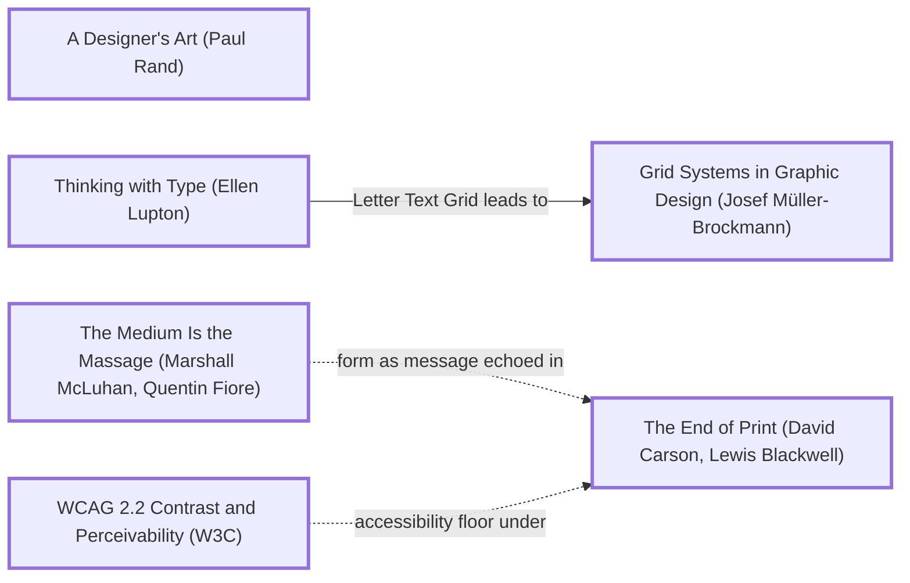

# DESIGN-LOG: Learn Java, "from the bytes up"

DADA run, 2026-11-11. Repo: SolutionsAsService/LearnJava, which was empty when the run started.

## 1. Traversal Plan

**Brief, one sentence:** build from scratch a beautiful multi-page site that teaches Java, then add it to the portfolio and the coding roadmap.

**Mode: Adaptive.** The site serves learners. MAYA governs: the advanced pole is a home page drawn from the real bytes of a compiled class; the acceptable pole is a numbered lesson path with code, output and the command to run it.

**Run type: Full.** The owner said "from scratch", "full run" and "new … website", and the repo is empty. That last fact is why R0 is skipped: there is no inherited artifact to premortem.

**Owner's words:** "do a from scratch dada run for Java website make sure dada has from scratch keywords for new full run aestitic website to learn Java then add to roadmap and portfolio". No bound was given.

**Before the run:** the requested keywords were added to DADA (dada-changes `b1de2c4`). The skill's description, the run-type rule and `dada.manual.json` (manual 1.2.0) now name from scratch, new site, full run, start over, rebuild and an empty repo as Full triggers.

### Tooling inventory (Step 0)
| Job | Tool used |
|---|---|
| Anchor graph | Mermaid text in this log |
| Frontier | grep over `references/anchor-graph.md` |
| Panel | Agent tool: one general-purpose agent per reference, at most three at a time, each writing a file into `panel/R<n>/` |
| Choose panel | `scripts/pick_panel.py --mode adaptive --run-type full --project learnjava --data-graphic` |
| Brief seats | `seats/<seat_id>.md` |
| Measure | Playwright (`_src/measure.cjs`, which enumerates every page in `site/`); the Mobile Floor via `scripts/check_floor.py`; javac, java and javap at build |
| Record the run | `import_log.py` and `rate_seats.py` in dada-changes |

### Seed (labels copied from the graph)
- Stance: **A Designer's Art (Paul Rand)**: wit, and a symbol the reader can decode.
- Rule: **Thinking with Type (Ellen Lupton)** --Letter Text Grid leads to--> **Grid Systems in Graphic Design (Josef Müller-Brockmann)**
- Breaker: **The Medium Is the Massage (Marshall McLuhan, Quentin Fiore)**: the class file, the medium Java actually travels in, becomes the message.
- Counterpoint (dotted): **The End of Print (David Carson, Lewis Blackwell)**, reached by `mcluhan -.->|form as message echoed in| carson`
- Floor: **WCAG 2.2 Contrast and Perceivability (W3C)**, plus the Mobile Floor (`references/mobile-standard.md`)

### Panel (from `pick_panel.py`, copied)
| Seat | Why |
|---|---|
| Critic: Provocateur (Debord) | required by the adaptive panel minimum |
| Critic: Provocateur (Shklovsky) | required by the adaptive panel minimum |
| Critic: Inclusion (Holmes) | required by the adaptive panel minimum |
| Critic: Inclusion (Mace) | required by the adaptive panel minimum |
| Critic: Evidence (Cairo) | required: the artifact can be inspected |
| Critic: Evidence (Tufte) | required: a data graphic gets the instrumentation seat |
| Critic: Usability (Krug) | rated 0.877 over 95 rounds |
| Critic: Aestheticist (Gautier) | rotation seat, 0 rounds on record |

Dotted pairs: Debord and Krug; Shklovsky and Krug. Content-owner witness: none. Java is a public standard; facts are checked against JDK 21 in this container and against the official sources linked on each page.

## Frontier
| Candidate | Reached via | From anchor | Status |
|---|---|---|---|
| Programme: every page generated from examples/ and the compiler | Lessons 44, 47, and the LearnC carry-forward | n/a | TAKEN (M1) |
| Type-led grid: the byte cell as the module | Letter Text Grid leads to | Thinking with Type (Ellen Lupton) | TAKEN (M2) |
| The class file as the hero and the site map | (Breaker) | The Medium Is the Massage (Marshall McLuhan, Quentin Fiore) | TAKEN (M3) |
| The magic number set huge, breaking the grid | form as message echoed in (dotted) | The End of Print (David Carson, Lewis Blackwell) | TAKEN (M3) |
| Shadw/Vercel config and the Mobile Floor from the first commit | website rule, floors | WCAG 2.2 Contrast and Perceivability (W3C) | TAKEN (M4) |

## Move M1: The programme: the compiler writes the evidence (KEEP-THE-RULE)
Depends on: none
Anchors: Rule Thinking with Type (Ellen Lupton)
Intent: every lesson page shows its program, the exact command, the JDK version and the real output, all written by `_src/build.py` after it compiles each file with `javac -Xlint:all` and runs it. The JVM page prints the real `javap -c` of Hello.
Formal argument: claim: a learning site's authority is its outputs. Grounds: the LearnC run's defects were all claims the build did not back. Warrant: the medium (compiler output) carries the message, so nothing is typed by hand.
Alternatives rejected: (1) a browser JVM (heavy, and it hides the real toolchain); (2) hand-written outputs, which drift.
Consequence: the build needs a JDK. Without one it reuses `_src/runs.json` and says so.
Fence: none broken.
Frontier effect: hero figures (bytes, version, pool size) become computable.
Mode field: Advanced pole: the compiler's own output as the content. Acceptable pole: code, then output, then the command; the most familiar teaching shape.

## Move M2: The byte cell as the module (KEEP-THE-RULE)
Depends on: M1
Anchors: Rule Thinking with Type (Ellen Lupton) | Rule Grid Systems in Graphic Design (Josef Müller-Brockmann)
Intent: the layout module is one byte, two hex digits of IBM Plex Mono. A 16-byte row (the width of a hex dump) sets the code column. Prose in Fraunces holds about 66 characters.
Alternatives rejected: a 12-column fluid grid, which is unrelated to the subject; full-bleed code, whose lines are too long.
Mode field: Advanced pole: the grid is the subject's own unit. Acceptable pole: an ordinary reading measure.

## Move M3: The home page is Hello.class (BREAK)
Depends on: M1, M2
Anchors: Stance A Designer's Art (Paul Rand) | Breaker The Medium Is the Massage (Marshall McLuhan, Quentin Fiore) | Counterpoint The End of Print (David Carson, Lewis Blackwell) (dotted edge from The Medium Is the Massage (Marshall McLuhan, Quentin Fiore))
Intent: the landing graphic is the complete compiled class file of the first lesson, every byte, drawn as a hex dump. Its regions are tinted and numbered: ① the magic number CA FE BA BE, ② the class-file version, ③ the constant pool, ④ the class header, ⑤ the main method's bytecode, ⑥ the attributes. Each region is a link to the page that explains it (the JVM page, Versions, the lessons, Ecosystem), and a `lessons[13]` strip links every lesson. The magic number is set enormous above the dump, so it breaks the grid. Every figure (file size, version 65, pool count, bytecode length) is parsed from the real file at build time.
Formal argument: McLuhan: the medium shapes the message. Java's medium is the class file, and almost no learner has ever seen one. Rand: a symbol earns its place when it is witty and true. CAFEBABE is both.
Alternatives rejected: (1) a coffee cup, a cliché and close to a trademark; (2) six topic cards, which are not a form; (3) a timeline, which shows one topic and not the site.
Consequence: a dense dump must open calm. Regions are tinted, the rest stays faint, and the numbered legend reads first. The phone version must fit 375 x 812.
Fence: the byte grid exists for reading code. The giant magic number breaks it once, on the home page only.
Frontier effect: the legibility probe (trace region ⑤ to the JVM page); the Mobile Floor at 360, 390 and 430.
Mode field: Advanced pole: the file is the image. Acceptable pole: a numbered legend in plain words, each item a link.

## Move M4: Deploy config and the Mobile Floor from the first commit (KEEP-THE-RULE)
Depends on: none
Anchors: Floor WCAG 2.2 Contrast and Perceivability (W3C)
Intent: `vercel.json` (root and site), `fluid.json`, a root redirect and a root-anchored `.vercelignore`, all checked by the build. The phone is designed first: one breakpoint, `clamp()` type with floors, 16px body, 44px targets and gated hover.
Mode field: Advanced pole: none; this is the floor. Acceptable pole: the whole of it.
